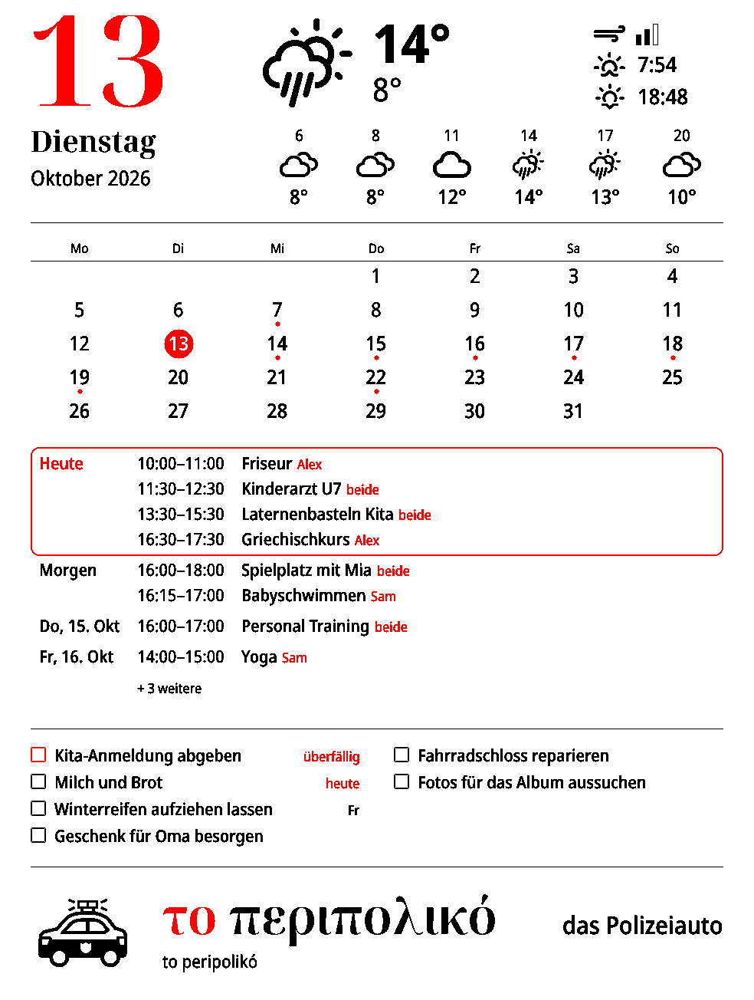

# inkycal-go

**A Go rewrite of [Inkycal](https://github.com/aceinnolab/Inkycal), tuned for battery life. Personal proof of concept.**

> **The original author is king.** Inkycal is the work of [aceisace](https://github.com/aceisace) and the
> [aceinnolab](https://github.com/aceinnolab) contributors. The ideas, the module set, the settings format and
> years of work on e-paper drivers all come from there. This port took little effort of my own: it was
> built almost entirely with agentic AI. I don't maintain it. If you use or like it, please
> **[sponsor the original project](https://github.com/sponsors/aceisace)**, which is actively maintained.

<p align="center"></p>

## What this is (and isn't)

- **What it is:** a rebuild of aceisace's Inkycal, ported to Go. Nothing here is a new invention. I took the original
  code and design and only tried to squeeze more battery life out of it for **my own device**: a
  Raspberry Pi Zero 2 W, a PiSugar 3 and a Waveshare 12.48" B/W/R V2. The rewrite was done *agentically*,
  with an AI coding agent writing the code and me reviewing, testing on the hardware and making the calls.
- **What it isn't:** a maintained product. I don't maintain this for anyone else: no support, no roadmap,
  no guarantee it runs on your hardware. Issues and PRs may go unanswered. Feel free to fork it or take
  ideas back to upstream.
- **Why:** I wanted to find out how far wake time per update could drop on a battery-powered frame.

## Findings

All values were measured on the real device. "Before" is my own Inkycal setup, which is a few months old
and has my customisations. Newer Inkycal releases may already be faster. I still want to compare against
the latest release.

| | Python Inkycal (my setup) | inkycal-go | |
|---|---|---|---|
| Boot until the system is ready | 11.4 s | 10.6 s | |
| Artificial `sleep 60` in the cron line | 60 s | 0 s | |
| Program start (Python imports) | ~14 s | ~0 s | single static binary |
| Fetching data (weather, 2 calendars, Todoist) | 21 s | 1.7 s | fetched in parallel |
| Display refresh (12.48" colour) | 61 s | 51 s | hardware SPI |
| Shutdown until power is cut | ~20 s | ~5 s | |
| **Wake time per update** | **~178 s** | **~70 s** | **~60% less** |

To be fair, 60 s of the "before" number is the `sleep 60`. Without it, the result is still **~40% less**
(~118 s → ~70 s). Most of what is left is the panel itself: the 12.48" colour panel needs 51 s to
redraw, and software can't change that.

What I learned along the way:

- **The OS matters as much as the app.** A stock Raspberry Pi OS (Trixie) image took ~31 s until WiFi
  was up, mostly because netplan made NetworkManager reload systemd three times. The fixes were
  `systemd-networkd` + `wpa_supplicant`, no Bluetooth, no graphics stack, fewer services and no initramfs.
  That brought it down to ~10 s. See [`deploy/tuning`](deploy/tuning). Each stage has a revert script and a
  dead-man switch, so a bad network config can't lock you out.
- **`pisugar-poweroff` is required.** Without it, the PiSugar never cuts power after shutdown, and then
  the RTC alarm can't wake the Pi again.
- **The 12.48" panel needs `dtoverlay=spi0-0cs`.** The panel drives its four chip selects over GPIO, and
  the default SPI driver would occupy two of them.
- **Calibration ("cleaning cycles") is expensive and optional.** On the 12.48" colour panel, 3 cycles take
  7–8 minutes. Waveshare asks for a full refresh at least every 24 h and a sleeping panel in between, but
  doesn't require cleaning cycles for full-refresh panels. I run with `calibration_hours: []`.
- **Skipping unchanged frames helps only if you update often.** Every frame is hashed, and an identical
  frame skips the 51 s refresh (~18 s wake). With one update a day, the date changes anyway.

## What's different from Inkycal

**Rewrite**

- **One static Go binary** (`CGO_ENABLED=0`, arm64/armv7/armv6) instead of Python + Pillow + driver libraries.
- **Works with your existing `settings.json`, including files from the
  [Inkycal web generator](https://inkycal.aceinnolab.com/ui).** Same model names, module names and keys; a
  test loads a generator-style file with every module.
- **Wakes at fixed times** with `update_times: ["06:00"]` via the PiSugar RTC, then powers off.
- **Maintenance mode:** put a file named `inkycal-maintenance` (or `.txt`) on the SD card's boot partition
  from any PC, or plug in USB power. The Pi then stays up for SSH instead of shutting down.
- **A short hint on the panel when something fails,** for example a dead calendar URL or an invalid
  Todoist token, instead of a blank module.

**Redesign** (opinionated, built for my wall)

- **Weather shows today only:** a tear-off-calendar style date, pictograms, high/low, sunrise/sunset, wind
  as a three-step gauge and a timeline from the update hour to the evening.
- **Calendar grid and event list share one layout.** Events are **grouped by day** (Today, Tomorrow,
  `Do, 15. Okt` …), and today's events sit in a red frame.
- **Todoist** is a two-column checklist sorted by urgency (overdue, today, upcoming).
- **All other modules follow the same type scale, grid and colour rules:** Feeds, Jokes, TextToDisplay,
  Stocks (with sparklines), Xkcd, Fullweather (chart and 5-day forecast) and the picture modules.
- **New module `Greek`:** a Greek word of the day for kids, with a German or English translation and a
  pictogram (366 words). It's a nice example of how small a module is.
- **Red is used for meaning only:** today, urgent things, losses, calendar labels.
- **Languages:** the modules' fixed words are English or German, following each module's `language`
  (`de`, `de_DE` …). Other languages fall back to English; adding one is a block in
  [`internal/i18n/i18n.go`](internal/i18n/i18n.go).

**My calendar changes** (from my old Python fork, now part of this rewrite)

- **Merge several calendars into one list**, with `dedupe_events`. Identical events show up once.
- **`calendar_labels`:** each event gets a red source label, e.g. `Alex`, `Sam` or `both` (`beide`) when it's
  in both calendars.
- **`weekday_prefix`:** abbreviated weekday before the date (`Sa, 25. Okt`).
- **Time ranges** (`16:00–17:30`) instead of start times only. Timed events over several days name the
  other day (`Mo 09:00–Do 18:00`), all-day ones their length (`Urlaub (3 Tage)`).

Some of my changes went upstream earlier: [improved multi-day events (#282)](https://github.com/aceinnolab/Inkycal/pull/282),
[optional calibration (#296)](https://github.com/aceinnolab/Inkycal/pull/296) and
[#287](https://github.com/aceinnolab/Inkycal/pull/287).

## Support matrix

**Displays.** Only one panel has ever run this code. All others are ported from upstream's drivers and
are **untested on hardware**. Most of them are verified byte for byte instead: [`tools/epdtrace`](tools/epdtrace)
runs the original Python driver against a fake SPI/GPIO layer, records every command and data byte it
would send, and a Go test checks that our driver sends exactly the same. That catches porting mistakes,
not wiring or timing problems. If you try one, please report back.

| Model (`"model"` in settings.json) | Status |
|---|---|
| `epd_12_in_48_colour_V2` | ✅ tested on hardware (my panel), and byte-identical |
| `epd_7_in_5`, `epd_7_in_5_colour`, `epd_7_in_5_v2`, `epd_7_in_5_v2_colour`, `epd_7_in_5_v3`, `epd_7_in_5_v3_colour` | 🔁 byte-identical, untested |
| `epd_4_in_2`, `epd_4_in_2_colour`, `epd_5_in_83`, `epd_5_in_83_colour`, `epd_5_in_83_V2`, `epd5in83b_V2` | 🔁 byte-identical, untested |
| `epd_13_in_3`, `epd_13_in_3_colour`, `epd_12_in_48`, `epd_12_in_48_colour` | 🔁 byte-identical, untested |
| `7_in_8`, `9_in_7`, `10_in_3` (IT8951 HAT, greyscale) | ⚠️ ported by hand from upstream's C program, **not** byte-verified, untested |
| `image_file`, `image_file_12_in_48` | writes the image to a file instead of a panel |

**Modules.** Weather, Fullweather, Calendar, Agenda, Feeds, Todoist, Jokes, TextToDisplay, Stocks, Xkcd,
Inkyimage, Slideshow, Inkyserver, plus Greek. Not ported: Webshot (needs a full browser on the Pi) and
Tindie.

## Installation

You need a Raspberry Pi with a supported panel, optionally a PiSugar 2/3 for battery mode
(tested: Pi Zero 2 W + PiSugar 3).

1. **Flash Raspberry Pi OS Lite** with [Raspberry Pi Imager](https://www.raspberrypi.com/software/). In the
   Imager's settings, set hostname, user, WiFi and enable SSH.
2. **Create `settings.json`** with the [Inkycal web generator](https://inkycal.aceinnolab.com/ui) and copy
   it onto the SD card's boot partition (the `bootfs` drive on Windows/Mac).
3. **Boot the Pi, log in via SSH and run:**

   ```bash
   curl -fsSL https://raw.githubusercontent.com/mygrexit/inkycal-go/main/deploy/install.sh | sudo sh
   ```

   It downloads the binary for your Pi, enables SPI, installs the service, stops an old Python Inkycal,
   renders a test image and starts. With a PiSugar it is detected automatically (force it with
   `sudo sh -s -- --pisugar`); then it also installs `pisugar-server` and `pisugar-poweroff` and switches
   on battery mode.
4. **Battery mode only:** the installer leaves a safety file so the Pi stays on while you check the panel.
   When everything looks right: `sudo rm /boot/firmware/inkycal-maintenance`.

Optional keys on top of upstream's:

```json
"update_times": ["06:00"],
"calibration_hours": [],
"dividers": true
```

Logs: `journalctl -u inkycal-go -f`. Way back in after going live: put an empty file `inkycal-maintenance`
on the boot partition from any PC, or plug USB power into the PiSugar.

### Grid layout (optional)

Modules can sit side by side. Give every module a `cell`, `[column, row, column span, row span]`
counted from 0, and optionally the grid size (default 12 × 16):

```json
"grid": {"columns": 12, "rows": 16},
"modules": [
  {"position": 1, "name": "Weather",  "config": {"cell": [0, 0, 12, 4], …}},
  {"position": 2, "name": "Calendar", "config": {"cell": [0, 4, 8, 12], …}},
  {"position": 3, "name": "Todoist",  "config": {"cell": [8, 4, 4, 12], …}}
]
```

The grid covers the panel above the info line. Either every module has a cell or none (then they
stack as in upstream). On a grid `size` is ignored; keep it for upstream Inkycal.

### Build from source

```bash
make test
make build-arm64                     # or build-armv7 / build-armv6
make deploy PI=pi@<pi-address> ARCH=arm64
```

[`deploy/image/build-image.sh`](deploy/image) builds a ready-to-flash image with WiFi, SSH key, PiSugar and
the service preconfigured. More details are in [`deploy/README.md`](deploy/README.md), measurements in
[`deploy/MESSUNGEN.md`](deploy/MESSUNGEN.md) and boot tuning in [`deploy/tuning`](deploy/tuning). These
docs are in German.

## License

GPL-3.0, like the original, from which the settings format and parts of the logic are derived. The display
drivers follow upstream's and Waveshare's reference implementations.
